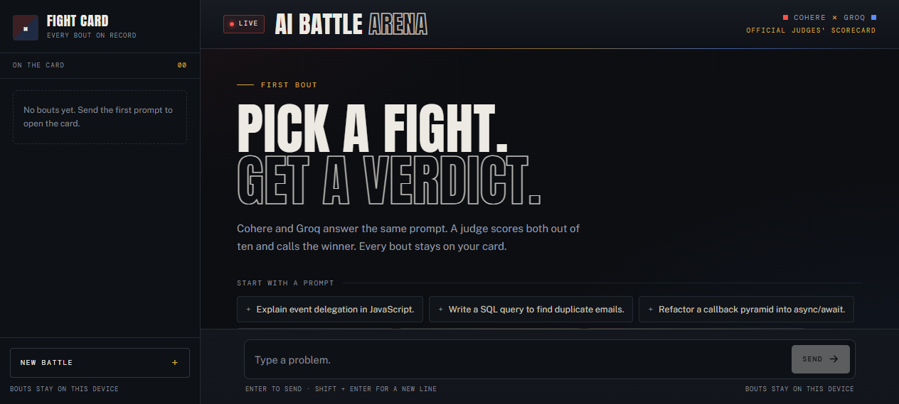

# ModelCompare

Pick two language models. Both answer the same prompt. A judge scores each answer out of ten, explains the scores, and declares a winner. Then you can share the scorecard, export it, or keep a running record of who wins your prompts.

**Live app:** https://modelcompare.furqankhan.dev
**API:** https://model-compare-api.onrender.com

The API runs on the replacement `model-compare-api` Render service.




## The idea

Public benchmarks are averages. What people actually feel is how two models handle *their* question. This app turns a single request into a head-to-head bout: you pick the two fighters, they answer in parallel, and a judge scores both sides on a 0 to 10 scale, explains the decision, and the result becomes evidence you can share with your team.

OpenRouter is the primary provider, so the fighter pair comes from a curated catalog instead of being fixed to two vendors. Until `OPENROUTER_API_KEY` is added, the API keeps working with its original Cohere and Groq path.

## Features

- **Choose the fighters**: two labelled selectors, Fighter A and Fighter B, backed by a curated OpenRouter catalog. The pair is saved in `localStorage` and restored on reload.
- **Head-to-head answers** from the selected models on the same prompt, generated in parallel.
- **Judge evidence**, not just numbers: each corner gets the judge's written reasoning, plus a compact verdict line explaining why the winner won (lifted from the judge's own feedback).
- **Same-model guard**: the send button is disabled when both selectors point at the same fighter, with an inline note.
- **Shareable battle reports**: one click packs the prompt, model names, both answers, scores, reasoning, and winner into a compressed URL-safe payload at `#b=<payload>`. Opening that link boots a read-only report with a "Run your own battle" path back into the arena.
- **Markdown export** of the full report for docs, tickets, or a team wiki.
- **Personal leaderboard** in the fight card: total bouts, wins per corner, draws, and average score per corner, computed from saved bouts.
- **Battle history** kept in `localStorage`, with numbered bouts, timestamps, and the last active battle restored on reload. Old saved battles that predate model names still display Cohere and Groq.
- **Cost and abuse protection**: per-IP rate limits, prompt length caps, a 60-second server timeout, and an in-memory LRU cache so repeated prompts do not re-bill the model APIs.
- **Starter prompts** for the empty state, so the first visit is not a blank page.
- **Copy any answer** with a short confirmation.
- **Error recovery**: failed battles show a dismissible banner with a retry action. Rate limits and timeouts get specific messages.
- **Broadcast UI**: fight-card rail, prompt card, split duel with a `VS` seam, and a judges' scorecard. Responsive from 320 px up, with visible focus states and `prefers-reduced-motion` support.
- **Keyboard-first composer**: `Enter` sends, `Shift` + `Enter` adds a line.

## Model catalog

The fighter catalog is defined in `backend/src/ai/models.ts`. IDs and labels were checked against the live `https://openrouter.ai/api/v1/models` response on 24 November 2026.

| Label | OpenRouter ID | Provider |
|---|---|---|
| GPT-4o-mini | `openai/gpt-4o-mini` | OpenAI |
| Claude Sonnet 5.5 | `anthropic/claude-sonnet-5.5` | Anthropic |
| Gemini 3.8 Flash | `google/gemini-3.8-flash` | Google |
| Llama 3.1 70B Instruct | `meta-llama/llama-3.1-70b-instruct` | Meta |
| Mistral Large | `mistralai/mistral-large` | Mistral AI |
| DeepSeek V3 | `deepseek/deepseek-chat` | DeepSeek |

The default pair is the first two entries: GPT-4o-mini and Claude Sonnet 5.5. The judge is fixed to `openai/gpt-4o-mini`, which is also the first fighter in the catalog. The judge is separate from the fighter selection, so choosing a different pair does not change how scoring works.

Only IDs in this list are accepted. A missing or unknown `modelA` or `modelB` falls back to the default pair instead of returning a 400. If both corners resolve to the same ID, the API moves Fighter B to the first different catalog entry.

## Architecture

```
React client (Vercel)
      │  GET /api/models
      │  POST /api/invoke { problem, modelA, modelB }
      ▼
Express API (Render)
      │
      ├── helmet + CORS
      ├── per-IP limits: 6/min, 40/hour
      ├── prompt validation: 2,000 chars
      ├── LRU cache: 100 entries, 30 min TTL, keyed by prompt + model pair
      ├── 60s timeout guard
      ▼
LangGraph StateGraph
   ├── solutionNode ──► OpenRouter model A  ┐
   │                  OpenRouter model B    ├─ run in parallel
   │                  (Cohere / Groq when no OpenRouter key)
   └── judgeNode ─────► OpenRouter GPT-4o-mini
                        (Groq when no OpenRouter key)
      │
      ▼
{ model_1, model_2, solution_1, solution_2,
  judge: { scores, feedback, winner } }
```

The OpenRouter path uses `@langchain/openai`'s `ChatOpenAI` with `configuration.baseURL` set to `https://openrouter.ai/api/v1`. Attribution headers are sent on every call: `HTTP-Referer: https://modelcompare.furqankhan.dev` and `X-Title: ModelCompare`.

The judge first tries `withStructuredOutput` with a zod schema. If the judge model rejects structured output or tool calling, the judge retries once with a JSON-only prompt, and the response is parsed defensively with zod. The winner is derived from the two scores, so the stored shape stays compatible with older reports.

## Tech stack

| Layer | Choice |
|---|---|
| Frontend | React 19, Vite, hand-written CSS design system, `lz-string` |
| Backend | Node.js, Express 5, TypeScript, `tsx` |
| Orchestration | LangGraph (`StateGraph`) |
| Models | OpenRouter for fighters and judge; Cohere and Groq as the no-key fallback; optional Gemini and Mistral clients included |
| Validation | zod v4 structured output and JSON fallback parsing |
| API hardening | `helmet`, `express-rate-limit`, in-memory LRU/TTL cache |
| Hosting | Vercel (web), Render (API) |

## Project structure

```
backend/
  server.ts                   Express bootstrap
  tsconfig.json               Type-check configuration
  src/app.ts                  API, CORS, hardening, model routing, cache wiring
  src/ai/graph.ai.ts          LangGraph battle graph
  src/ai/models.ts            Curated OpenRouter catalog and pair resolution
  src/ai/models.ai.ts         Provider clients (OpenRouter, Cohere, Groq)
  src/ai/judge.ts             Judge schema, prompts, JSON parser, winner logic
  src/config/config.ts        Environment config and OpenRouter defaults
  src/lib/lruCache.ts         100-entry / 30-min in-memory LRU cache
  src/lib/prompt.ts           2,000-character validation + pair-aware cache keys
  src/lib/rateLimit.ts        Per-IP minute and hour limiters
  src/lib/timeout.ts          60s Promise.race guard
frontend/
  src/features/chat/
    page/ChatPage.jsx          Arena state, model selection, saved-card hydration
    page/SharedReportPage.jsx  Read-only shared report shell
    components/               Fight card, fighter picker, battle view, composer, empty state
    lib/battles.js            Storage, labels, formatting, verdict and error helpers
    lib/models.js             Catalog fallback, pair normalization, selection storage
    lib/share.js              `#b=` encode/decode, limits, shared-link errors
    lib/report.js             Markdown report builder and download
    lib/stats.js              Personal leaderboard aggregation
    lib/limits.js             Shared prompt-length constant
    services/chat.api.js      API client
  src/features/legal/
    page/                     Privacy and Terms pages
    components/               Legal page shell and footer links
  src/app/App.jsx             Arena, privacy, and terms path guard
  src/app/App.css             Design system and layout
  public/robots.txt           Crawler rules and sitemap pointer
  public/sitemap.xml          Home, privacy, and terms URLs
```

## Run locally

```bash
# API
cd backend
npm install
cp .env.example .env       # add OPENROUTER_API_KEY, or Cohere and Groq
npm run dev                # http://localhost:3000

# Web
cd frontend
npm install
npm run dev                # http://localhost:5173
```

Type-check the API with `npm run typecheck`. Test the API with `npm test`. Lint and build the web app with `npm run lint` and `npm run build`.

### Environment variables

| Key | Default | Purpose |
|---|---|---|
| `PORT` | `3000` | API port (Render provides this in production) |
| `OPENROUTER_API_KEY` | empty | Primary switch. When set, both fighters and the judge use OpenRouter |
| `OPENROUTER_BASE_URL` | `https://openrouter.ai/api/v1` | OpenRouter API base URL |
| `OPENROUTER_HTTP_REFERER` | `https://modelcompare.furqankhan.dev` | Attribution header sent to OpenRouter |
| `OPENROUTER_APP_TITLE` | `ModelCompare` | App title header sent to OpenRouter |
| `COHERE_API_KEY` | empty | Fallback red corner when OpenRouter is not configured |
| `GROQ_API_KEY` | empty | Fallback blue corner and fallback judge |
| `GOOGLE_API_KEY` | empty | Optional Gemini client, not on the main path |
| `MISTRALAI_API_KEY` | empty | Optional Mistral client, not on the main path |

**Production setup:** add `OPENROUTER_API_KEY` in the Render dashboard for the API service. The base URL, referer, and title already default correctly, so the key is the only required change. With OpenRouter configured, the Cohere and Groq keys are not required. Until the key is added, Render keeps using the existing Cohere and Groq path.

No new environment variables are required for sharing, caching, or rate limiting.

## API

### `GET /api/models`

```json
{
  "models": [
    { "id": "openai/gpt-4o-mini", "label": "GPT-4o-mini", "provider": "OpenAI" },
    { "id": "anthropic/claude-sonnet-5.5", "label": "Claude Sonnet 5.5", "provider": "Anthropic" }
  ],
  "defaultPair": {
    "modelA": "openai/gpt-4o-mini",
    "modelB": "anthropic/claude-sonnet-5.5"
  }
}
```

The example above is shortened. The live response returns all six catalog entries.

### `POST /api/invoke`

```json
{
  "problem": "Explain database indexes to a junior developer",
  "modelA": "anthropic/claude-sonnet-5.5",
  "modelB": "google/gemini-3.8-flash"
}
```

```json
{
  "success": true,
  "message": "Graph Executed Successfully!",
  "cached": false,
  "result": {
    "model_1": "Claude Sonnet 5.5",
    "model_2": "Gemini 3.8 Flash",
    "solution_1": "...",
    "solution_2": "...",
    "judge": {
      "solution_1_score": 8,
      "solution_2_score": 7,
      "solution_1_feedback": "...",
      "solution_2_feedback": "...",
      "winner": "solution_1"
    }
  }
}
```

`cached: true` means the response came from the in-memory cache and no model call was made. The cache key includes the trimmed prompt, `modelA`, and `modelB`, so the same prompt on a different pair is not served from the old entry.

`model_1` and `model_2` are display labels for the models that actually answered. In fallback mode they are `Cohere` and `Groq`, regardless of the requested pair.

### Error responses

| Status | Body | Cause |
|---|---|---|
| `400` | `{ "error": "...", "code": "PROMPT_TOO_LONG" }` | Prompt over 2,000 characters, empty prompt, bad JSON, or oversized body |
| `429` | `{ "error": "...", "retryAfter": 42 }` | More than 6 requests/minute or 40/hour from one IP; also sends `Retry-After` |
| `504` | `{ "error": "...", "code": "TIMEOUT" }` | Model work exceeded 60 seconds |
| `500` | `{ "error": "..." }` | Upstream/provider failure |

Unknown model IDs are not an error. They fall back to the default pair.

`GET /health` returns `{ "ok": true, "uptime": 123 }` where `uptime` is process uptime in seconds. `GET /` still returns the plain health string.

## Limits and abuse protection

| Control | Value |
|---|---|
| Prompt length | 2,000 characters (enforced on client and server) |
| Burst limit | 6 requests / minute / IP |
| Hourly limit | 40 requests / hour / IP |
| Upstream timeout | 60 seconds |
| Response cache | 100 entries, 30-minute TTL, keyed by trimmed prompt and fighter pair |
| Share link payload | 16,000 encoded characters |

The cache and rate limits are **process-local and in-memory**. They reset when the API restarts or redeploys and are not shared across instances. There is no database. The timeout ends the client request but does not cancel model calls already in flight; use a shorter prompt if provider latency is consistently high.

## Sharing and export

- **Share report** compresses `{ prompt, model names, answers, scores, feedback, winner, date }` with `lz-string`'s `compressToEncodedURIComponent` and places it at `#b=<payload>` in the current URL. The link is copied to the clipboard when the browser allows it.
- Opening a `#b=` URL mounts a read-only report: no fight card, no composer, and no `localStorage` write. The shared report is labelled clearly and offers **Run your own battle**.
- Older share links that do not contain model names still open, and they display Cohere and Groq.
- Corrupt or oversized payloads show a friendly error instead of a broken page. Reports that would exceed the 16,000-character encoded limit are rejected with a pointer to **Export report**.
- **Export report** downloads a Markdown file containing the prompt, model names, both answers, scores, judge reasoning, verdict, and winner.
- Shared content lives entirely in the URL. Anyone with the link can read it, and chat apps may truncate very long URLs. Treat shared prompts and answers as public, and prefer export for long or sensitive reports.

## Fallback behavior

When `OPENROUTER_API_KEY` is empty:

- `GET /api/models` still returns the catalog and default pair, so the client stays usable.
- `POST /api/invoke` ignores the requested pair and runs the original Cohere and Groq fighters.
- The result reports `model_1: "Cohere"` and `model_2: "Groq"`, so the fight card and exports stay honest about what answered.
- The judge is Groq, using the same structured-output path as before.
- No OpenRouter request is attempted.

When the key is present, no Cohere or Groq request is made for a normal battle.

## Deployment notes

- The API runs on Render's free plan, so the first request after idle can take ~50 seconds to wake. The 60-second bout timeout still applies after the request starts.
- Add `OPENROUTER_API_KEY` on Render before expecting the selectable models to answer. The API deploys and boots without it.
- The client calls the Render API directly; CORS is restricted to the production domain plus localhost.
- Rate limiting uses `trust proxy` set to 1 so the client IP comes from the hosting proxy.
- `frontend/vercel.json` rewrites client routes to `index.html`. Share links use the URL hash, so no server route is needed.

## License

MIT. See [LICENSE](LICENSE).
