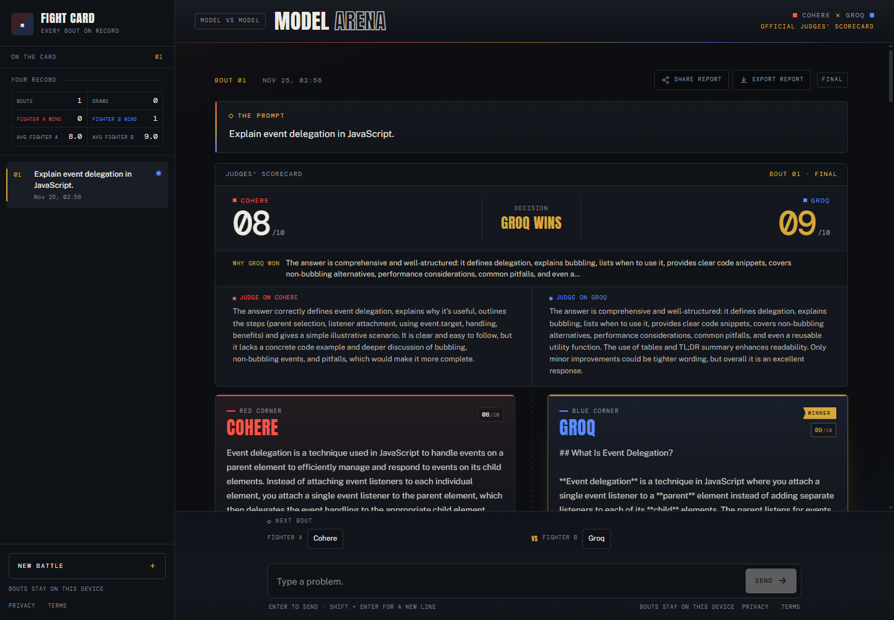

# ModelCompare

> Pick two models. A third judge keeps score.

[](https://modelcompare.furqankhan.dev)
[](https://furqankhan.dev)
[](LICENSE)

ModelCompare is a head-to-head arena for language models. Two chosen models answer the same prompt in parallel, then a fixed judge scores both answers out of ten and explains each score. The winner is derived from those scores. It is for comparing models on your own questions instead of relying on public averages. Part of [Furqan Khan's portfolio](https://furqankhan.dev).

**Live:** https://modelcompare.furqankhan.dev · **Source:** https://github.com/fk219/model-compare · **Case study:** https://furqankhan.dev




## What it is

The app turns one prompt into a bout. Fighter A and Fighter B answer the same question. The judge produces a score from 0 to 10 for each corner and written reasoning for both; the winner is computed from the scores. The result is shown as a split duel with a judges' scorecard, and it can be shared as a read-only report, exported as Markdown, or kept on a local fight card.

There is no account system and no database. Saved bouts, the selected model pair and the arena record live in `localStorage`. A shared report lives entirely in the URL, so the link carries the prompt, both answers, the scores, the reasoning and the winner.

## The signature idea

The judge is a separate role from the fighters. Both answers are generated in parallel, then one judge call evaluates them against the prompt. The judge is fixed to `openai/gpt-4o-mini` when OpenRouter is configured, independent of the selected pair, so changing fighters does not change how scoring works. That model is also the first catalog entry, so a bout can use the same model as one fighter and as the judge; the calls and roles are still separate.

The OpenRouter path asks for structured output through a zod schema. If the judge model rejects structured output or tool calling, the judge retries once with a JSON-only prompt and the reply is parsed defensively. The winner is derived from the two scores, not invented by the judge, so ties and older reports stay consistent.

## Model catalog

| Label | OpenRouter ID | Provider |
|---|---|---|
| GPT-4o-mini | `openai/gpt-4o-mini` | OpenAI |
| Claude Sonnet 5.5 | `anthropic/claude-sonnet-5.5` | Anthropic |
| Gemini 3.8 Flash | `google/gemini-3.8-flash` | Google |
| Llama 3.1 70B Instruct | `meta-llama/llama-3.1-70b-instruct` | Meta |
| Mistral Large | `mistralai/mistral-large` | Mistral AI |
| DeepSeek V3 | `deepseek/deepseek-chat` | DeepSeek |

The catalog is defined in `backend/src/ai/models.ts`. IDs and labels were checked against OpenRouter's live model list on 24 November 2026. The default pair is GPT-4o-mini and Claude Sonnet 5.5.

Only catalog IDs are accepted. A missing or unknown `modelA` or `modelB` falls back to the default pair instead of returning a 400. If both corners resolve to the same ID, the API moves Fighter B to the first different catalog entry.

Without `OPENROUTER_API_KEY`, the arena ignores the requested pair and fights with Cohere and Groq. `/api/models` reports `mode: "fallback"`, returns those two entries and includes a notice; the frontend locks the selectors to that demo pair. The deployed API was in this mode when this README was checked.

## What works

**The arena**

- Two labelled selectors, Fighter A and Fighter B, backed by the catalog and grouped by provider. The pair is saved in `localStorage` and restored on reload.
- A same-model guard disables the send button and explains why when both selectors point at the same fighter.
- Both answers are requested in parallel from the same prompt.
- A judges' scorecard with both scores, written reasoning per corner, a winner ribbon and a compact verdict line taken from the judge's own feedback.
- Ties are supported and displayed as a draw.
- A failed battle shows a dismissible banner with a Retry action. Rate limits and timeouts get specific messages.

**Reports and history**

- One-click sharing packs the prompt, model labels, both answers, scores, reasoning, winner and date into a compressed `#b=<payload>` URL with `lz-string`.
- Opening a share link mounts a read-only report with no fight card, composer or `localStorage` write, plus a **Run your own battle** path back to the arena.
- Corrupt or oversized reports show a friendly error. Reports above the 16,000-character encoded limit are rejected with a pointer to export.
- Markdown export downloads the prompt, model labels, both answers, scores, judge reasoning, verdict and winner.
- A local fight card keeps numbered bouts with timestamps, restores the last active bout and shows a personal record: total bouts, wins per corner, draws and average score per corner.
- Starter prompts fill the empty state, each answer can be copied, and fenced code in answers is rendered as code.

**Interface and limits**

- Broadcast-style layout: fight-card rail, prompt card, split duel with a VS seam and a judges' scorecard.
- Responsive from 320 px up, with visible focus states and `prefers-reduced-motion` support.
- `Enter` sends; `Shift` + `Enter` adds a line.
- Prompt cap of 2,000 characters, enforced on client and server.
- Per-IP limits of 6 requests per minute and 40 per hour.
- A 60-second upstream timeout, a 16 KB JSON body cap, and a 100-entry in-memory cache with a 30-minute TTL keyed by trimmed prompt and fighter pair.
- `helmet` headers, CORS restricted to the production app plus localhost, and duplicate-pair resolution on the server.

## Tech stack in detail

| Layer | Technology | What it does here |
|---|---|---|
| Web client | React 19, Vite 8 | Arena, shared report, legal pages and local history |
| Styling | Tailwind CSS 4 plus a custom CSS system | Broadcast layout, fight-card rail, responsive duel and scorecard |
| API | Node.js 22, Express 5, TypeScript 7, `tsx` | Typed REST API under `/api`, plus `/` and `/health` |
| Orchestration | LangGraph `StateGraph` | A solution node followed by a judge node |
| Providers | `@langchain/openai`, `@langchain/cohere`, `@langchain/groq` | OpenRouter through an OpenAI-compatible client; Cohere and Groq fallback |
| Optional clients | `@langchain/google`, `@langchain/mistralai` | Gemini and Mistral clients, present but not on the main path |
| Validation | zod v4 | Structured judge output and defensive JSON fallback parsing |
| Caching and limits | Custom LRU/TTL cache, `express-rate-limit` | Response reuse and per-IP minute/hour limits |
| Hardening | `helmet`, CORS allowlist, compression | Headers, origin checks and a 16 KB body cap |
| Hosting | Vercel, Render | Static web app and API service |

## Architecture

The React client runs on Vercel and calls the Render API directly. Express resolves the requested pair against the curated catalog, validates the prompt, checks the in-memory cache and runs the LangGraph battle inside a 60-second timeout. The solution node launches both model calls in parallel; the judge node runs after both answers return. A cached battle is returned without a provider call and marked `cached: true`.

There is no database. The browser stores the fight card, model pair and leaderboard locally. Share links carry a compressed, versioned payload in the URL hash, so opening one does not need a server route.

```
React client (Vercel)
      |  GET /api/models
      |  POST /api/invoke { problem, modelA, modelB }
      v
Express API (Render)
      |-- helmet, CORS, JSON cap
      |-- per-IP limits: 6/min, 40/hour
      |-- prompt validation: 2,000 characters
      |-- LRU cache: 100 entries, 30 min TTL
      |-- 60 s timeout guard
      v
LangGraph StateGraph
   |-- solution node --> OpenRouter model A  --|
   |                    OpenRouter model B  --| parallel
   |                    (Cohere / Groq when no OpenRouter key)
   `-- judge node ----> OpenRouter GPT-4o-mini
                        (Groq when no OpenRouter key)
      |
      v
{ model_1, model_2, solution_1, solution_2,
  judge: { scores, feedback, winner } }
```

```
backend/
  server.ts                     Express bootstrap
  src/app.ts                    API, CORS, hardening, cache wiring
  src/ai/graph.ai.ts            LangGraph battle graph
  src/ai/models.ts              Catalog and pair resolution
  src/ai/models.ai.ts           Provider clients
  src/ai/judge.ts               Judge schema, prompts, JSON parser, winner logic
  src/config/config.ts          Environment config and OpenRouter defaults
  src/lib/lruCache.ts           100-entry / 30-minute LRU cache
  src/lib/prompt.ts             2,000-character validation and cache keys
  src/lib/rateLimit.ts          Per-IP minute and hour limiters
  src/lib/timeout.ts            60-second Promise.race guard
  src/**/*.test.ts              24 tests for prompt, cache, catalog and judge
frontend/
  src/app/App.jsx               Arena, privacy and terms path guard
  src/app/App.css               Tailwind import, tokens and layout
  src/features/chat/
    page/ChatPage.jsx            Arena state, selection and history
    page/SharedReportPage.jsx    Read-only shared report
    components/                  Fight card, picker, duel, composer, empty state
    lib/                         Battles, models, sharing, reports, stats, limits
    services/chat.api.js         API client
  src/features/legal/            Privacy and terms pages
  public/robots.txt              Crawler rules
  public/sitemap.xml             Home, privacy and terms URLs
docs/
  preview.png battle.png
frontend/vercel.json             SPA fallback
.github/workflows/ci.yml         API tests, typecheck, web lint and build
.github/workflows/uptime.yml     Scheduled health checks
```

## Run it locally

Prerequisites: Node.js 22 (see `.nvmrc`) and npm. Configure either `OPENROUTER_API_KEY`, or both `COHERE_API_KEY` and `GROQ_API_KEY` for fallback mode.

```bash
# API
cd backend
npm install
cp .env.example .env         # add OPENROUTER_API_KEY, or Cohere and Groq
npm run dev                  # http://localhost:3000

# Web
cd ../frontend
npm install
cp .env.example .env.local   # VITE_API_URL=http://localhost:3000
npm run dev                  # http://localhost:5173
```

The frontend has no Vite proxy. Without `VITE_API_URL`, it calls the deployed Render API. The `.env.example` value points local development at `http://localhost:3000`.

On PowerShell, replace `cp` with `Copy-Item`.

### Environment variables

| Name | Required | Purpose |
|---|---|---|
| `PORT` | No | API port; defaults to `3000` |
| `OPENROUTER_API_KEY` | No | Primary switch; when set, fighters and judge use OpenRouter |
| `OPENROUTER_BASE_URL` | No | OpenRouter base URL; defaults to `https://openrouter.ai/api/v1` |
| `OPENROUTER_HTTP_REFERER` | No | Attribution header; defaults to the production app URL |
| `OPENROUTER_APP_TITLE` | No | Attribution title; defaults to `ModelCompare` |
| `COHERE_API_KEY` | No | Fallback red corner when OpenRouter is not configured |
| `GROQ_API_KEY` | No | Fallback blue corner and fallback judge |
| `GOOGLE_API_KEY` | No | Optional Gemini client, not on the main path |
| `MISTRALAI_API_KEY` | No | Optional Mistral client, not on the main path |
| `CORS_ORIGINS` | No | Comma-separated allowed origins; defaults to localhost and the production app |
| `VITE_API_URL` | No | Frontend API origin; defaults to the deployed Render API |

No account is required to use the UI. A battle needs a provider key on the API; without one, `/api/invoke` returns a 500 with the missing-key message from the fallback client.

## API

| Method | Path | Purpose |
|---|---|---|
| `GET` | `/health` | API status and process uptime in seconds |
| `GET` | `/` | Plain health string |
| `GET` | `/api/models` | Catalog, default pair and active `mode` |
| `POST` | `/api/invoke` | Run one battle |

`GET /api/models` returns `mode: "openrouter"` with all six entries when the key is present, or `mode: "fallback"` with Cohere, Groq and a notice when it is not.

`POST /api/invoke` accepts:

```json
{
  "problem": "Explain database indexes to a junior developer",
  "modelA": "anthropic/claude-sonnet-5.5",
  "modelB": "google/gemini-3.8-flash"
}
```

The response contains `model_1`, `model_2`, `solution_1`, `solution_2` and a `judge` object with `solution_1_score`, `solution_2_score`, both feedback strings and `winner` (`solution_1`, `solution_2` or `tie`). `cached: true` means the in-memory cache answered and no model call was made.

| Status | Cause |
|---|---|
| `400` | Empty prompt, over 2,000 characters, invalid JSON or oversized body |
| `429` | More than 6 requests per minute or 40 per hour from one IP; sends `Retry-After` |
| `504` | The bout exceeded 60 seconds |
| `500` | Upstream provider failure or missing provider configuration |

Unknown model IDs are not an error. They resolve to the default pair.

## Tests

```bash
cd backend
npm test                     # 24 tests: prompt, cache, catalog, judge
npm run typecheck            # tsc --noEmit

cd ../frontend
npm run build                # production build
npm run lint                 # ESLint
```

The API tests pass locally and do not call an external model provider. The web build and lint pass.

## Deployment

- The web app is on Vercel. `frontend/vercel.json` rewrites all client paths to `index.html`; there is no API proxy.
- The client calls `https://model-compare-api.onrender.com` by default. CORS is restricted to the production domain plus localhost.
- The API is on Render's free plan. The first request after idle can take around 50 seconds; the 60-second bout timeout starts after the request reaches the API.
- Add `OPENROUTER_API_KEY` in the Render dashboard to turn on the six-model catalog. The base URL, referer and title already default correctly. Without the key, the API stays on the Cohere and Groq path.
- `trust proxy` is set to 1 so rate limits key on the client IP from the hosting proxy.
- GitHub Actions runs API tests and typecheck plus web lint and build. A separate scheduled workflow pings the production `/health` endpoint every 30 minutes, alongside three other portfolio APIs.

## Limits and notes

- There is no database. The fight card, model pair and leaderboard are per browser; clearing storage removes them.
- Shared reports live in the URL. Anyone with the link can read the prompt and both answers, and chat apps can truncate long URLs. Prefer Markdown export for long or sensitive reports.
- Share payloads are capped at 16,000 encoded characters. Older links without model names still open and display Cohere and Groq.
- The judge is fixed to GPT-4o-mini on the OpenRouter path. It is not selectable, and a bout can use that model as both Fighter A and the judge.
- The response cache and rate limits are process-local and in memory. They reset on restart, are not shared across instances, and can return a 30-minute-old result for the same prompt and pair.
- The 60-second timeout stops the client waiting but does not cancel model calls already in flight.
- Fallback mode ignores the requested pair and labels the result Cohere and Groq.
- The endpoint is public and unauthenticated; abuse protection is the per-IP limit.
- Only the six catalog IDs can reach a provider; unknown IDs fall back to the default pair. A missing key never unlocks an arbitrary provider ID.
- The API runs on a free Render instance, so cold starts can be slow.

## License

MIT. See [LICENSE](LICENSE).
